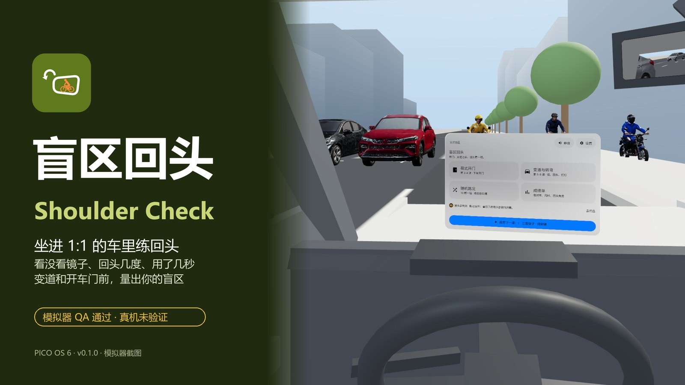
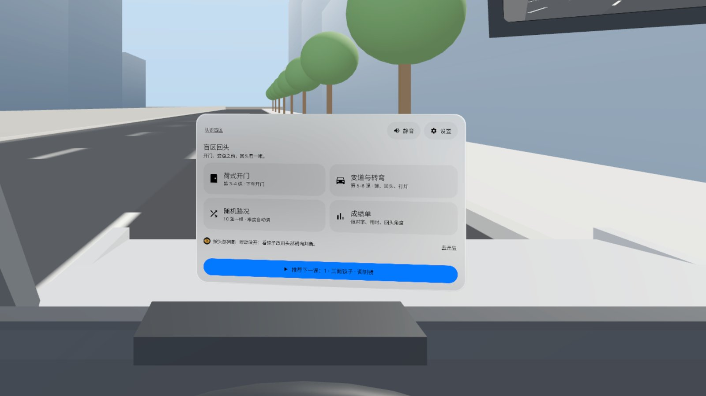
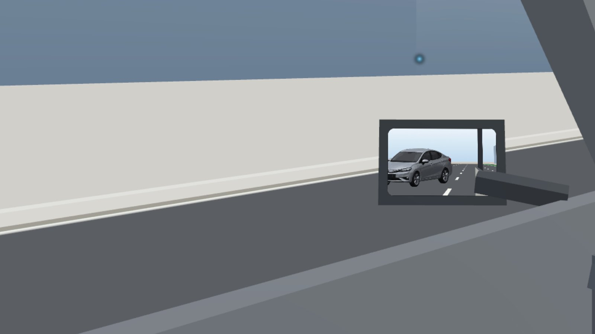
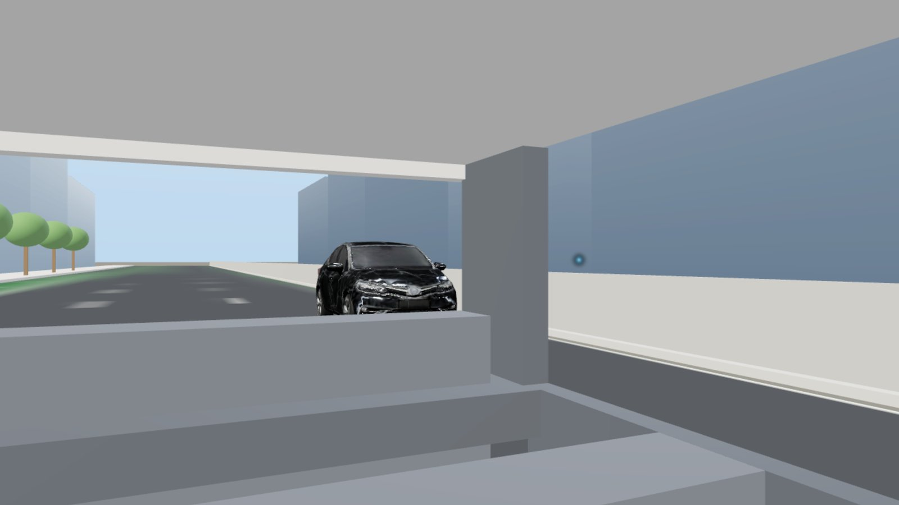
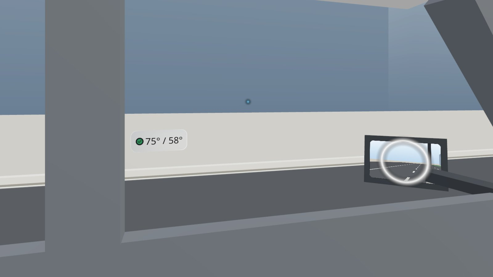
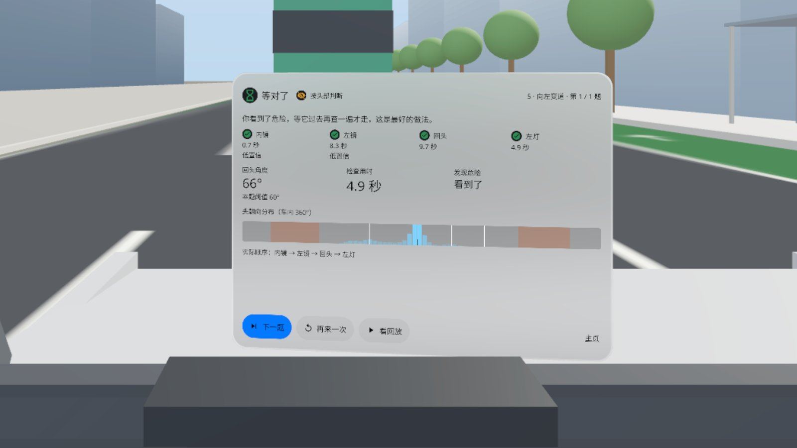
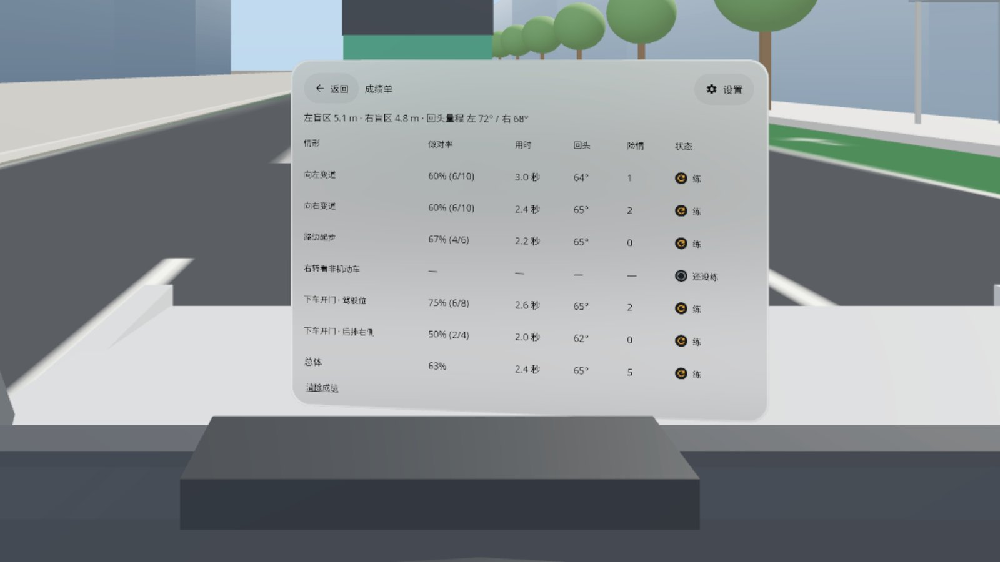

# 盲区回头 Shoulder Check

> **v0.1.0 · 预发布 · 模拟器 QA 通过，真机未验证**（Pre-release · passed emulator QA, not yet verified on a headset）



[中文](#中文) · [English](#english)

---

## 中文

坐进 1:1 的车里练两个救命动作：下车前用远侧手开门、回头看后方的电动车；变道前看镜子、回头、打灯。PICO OS 6 应用：头没转到位、眼睛没看到，那辆车就从盲区里冲出来。练完拿到一张成绩单：每种情形的做对率、检查用时、回头角度。

- **8 课**：三面镜子 · 调侧镜 → 盲区在哪 → 下车开门（驾驶位 / 后排右侧）→ 向左变道 → 向右变道 → 路边起步 → 右转看非机动车
- **随机路况**：每组 10 题，难度随你的表现升降，组末出成绩
- **量你自己**：第 1 课调镜时算出你左右两侧的盲区长度；开始前量一次你的回头量程，回头够不够按你自己的量程判
- **每题结果卡**：步骤时间线（内镜 / 侧镜 / 回头 / 打灯）、回头角度、检查用时、有没有看到那辆车，以及安全 / 等对了 / 侥幸 / 险情 / 超时
- **镜子是真的镜子**：三面镜子里看到的车，和你回头看到的车位置一致；车进了盲区就从镜子里消失
- 眼动可用时用眼动判断看没看镜子，不可用时改用头部朝向；中英双语，不联网、不需要账号

### 截图（模拟器，中文界面）

| | |
|---|---|
|  坐进驾驶位：在中控屏上选课 |  看左镜：后方 15 米的轿车还在镜子里 |
|  回头：盲区里的车在后侧窗里露出车头 |  回头时 B 柱旁的读数：这次 75°，本题要 58° |
|  每题结果卡：等对了，看到了危险，等它过去再变道 |  成绩单：左右盲区长度、回头量程、每种情形的做对率 |

截图来自 PICO 模拟器（High Definition 2560），状态用调试命令定住拍摄。演示视频（Release 附件 `ShoulderCheck-demo-1080p.mp4`）是模拟器上由调试输入驱动的演示，**非真实手势录像**，无声。

### 安装

```bash
adb install -r ShoulderCheck-v0.1.0.apk
pico-cli app launch io.embodit.shouldercheck
```

APK 在 [Release v0.1.0](https://github.com/kejing-dev/ShoulderCheck/releases/tag/v0.1.0)。需要 PICO OS 6（Spatial SDK 6.1.9，minSdk 35）。第一次启动会申请眼动权限，拒绝也能用（改用头部朝向）。

### 真机未验证

模拟器上过了三道门禁（无 Material 组件、启动 60 秒无崩溃 / ANR、23 / 23 个状态截图核对），用模拟器捏合和真实转动相机走通了一道变道题。下面这些只有戴上头显才能确认：

- 眼动模式：用注视点判断看镜 / 回头、回放注视轨迹（模拟器上眼动没有权限，整轮都在头部模式）
- 手柄：摇杆打灯、A 执行、B 关门、握把开门、手柄射线点面板
- 手势开门（手在门把 0.15 米内捏合保持），以及它和系统捏合会不会冲突
- 音效响度；5 秒内能不能自然地完成看镜 → 回头 → 执行

### 已知问题（不挡用）

1. 头部模式下看完左镜接着往后回头，会作废那次看镜，结果卡显示「左镜 ✗」（眼动可用时不走这条规则）。
2. 「银色轿车」在场景光照下接近黑色，镜中剪影是银色。
3. 抬头 30° 冷启动时中控屏在视野下沿，要低头才能看全。
4. 轿车 / SUV 比设计宽 14–16%（可能把后视镜算进了宽度）。
5. 模拟器上转相机太慢，5 秒新鲜窗很难完成；真机转头快得多。
6. 前方公交是程序生成的盒子，近看较粗糙。
7. 模拟器空闲帧率下场景要建约 22 秒，帧率拉满约 2 秒。
8. 应用常驻内存约 640 MB（三面镜子 20 Hz 刷新），模拟器内存吃紧时会先被杀。
9. 环境车流里的轿车车牌是空白的。

### 开发

Kotlin · PICO Spatial SDK 6.1.9。结构、调试命令、截图脚本见 [AGENTS.md](AGENTS.md)。

素材致谢：5 个外部车辆 / 骑手模型（轿车、SUV、电动车 + 骑手、自行车 + 骑手、摩托车 + 骑手）由 [Tripo](https://www.tripo3d.ai/) 生成，减面、校准尺寸后随应用打包（原始导出文件不在仓库里）；车内、街道和公交由程序生成；字体 Noto Sans / Noto Sans SC（SIL OFL 1.1，见 `third_party/`）。

---

## English

Sit in a life-size car and drill two life-saving habits: open the door with your far hand and look back for the e-bike before you get out; check mirrors, look over your shoulder and signal before you change lanes. A PICO OS 6 app: turn too little or miss it with your eyes, and the vehicle in your blind spot cuts in. You leave with a scorecard: correct rate, check time and head-turn angle for each situation.

- **8 lessons**: mirrors and how to set them → where the blind spot is → Dutch reach (driver / rear right passenger) → change lane left → change lane right → pull out from the kerb → right turn: check for bikes
- **Random traffic**: sets of 10 with difficulty that follows your results, and a score at the end of each set
- **Measures you**: lesson 1 works out your left and right blind-spot length as you set the mirrors; your head-turn range is measured once at the start and every look-back is judged against it
- **Result card per trial**: step timeline (rear-view / side mirror / look back / signal), head-turn angle, check time, whether you saw the vehicle, and safe / waited / lucky / near miss / timed out
- **Real mirrors**: what you see in the three mirrors matches where the car is when you look back; a car entering the blind spot disappears from the mirror
- Eye tracking judges mirror checks when available, head direction otherwise; Chinese and English, offline, no account

### Screenshots

See the table above (Chinese UI on the PICO emulator, High Definition 2560, states pinned with debug commands). The demo video in the release (`ShoulderCheck-demo-1080p.mp4`) is driven by debug input on the emulator — **not a recording of real hand gestures** — and has no sound.

### Install

```bash
adb install -r ShoulderCheck-v0.1.0.apk
pico-cli app launch io.embodit.shouldercheck
```

Get the APK from [Release v0.1.0](https://github.com/kejing-dev/ShoulderCheck/releases/tag/v0.1.0). Requires PICO OS 6 (Spatial SDK 6.1.9, minSdk 35). The app asks for eye tracking on first launch; it still works if you decline (head direction instead).

### Not yet verified on a headset

It passed three emulator gates (no Material components, 60 s launch with no crash / ANR, all 23 states captured and checked), and one lane-change trial was completed with emulator pinches and real camera turns. Only a headset can confirm: eye mode (gaze-based mirror checks and gaze replay); the controller (stick to signal, A to go, B to close the door, grip to open it, ray on panels); hand-gesture door opening and whether it clashes with the system pinch; sound level and whether mirror → look back → go fits naturally in the 5 s window.

### Known issues (non-blocking)

1. In head mode, checking the left mirror and then turning further to look back cancels the mirror check ("left mirror ✗"); eye mode does not use this rule.
2. The "silver sedan" looks nearly black in the scene while its mirror silhouette is silver.
3. Cold start while looking up 30°: the centre display sits at the bottom of the view.
4. Sedan / SUV are 14–16% wider than designed (mirrors probably counted in the width).
5. Camera turns on the emulator are too slow for the 5 s window; real head turns are much faster.
6. The bus ahead is a generated box and looks rough up close.
7. Scene build takes ~22 s at idle emulator frame rate, ~2 s at full rate.
8. The app holds ~640 MB (three mirrors at 20 Hz) and is killed first when the emulator runs low on memory.
9. Traffic sedans have blank number plates.

### Development

Kotlin · PICO Spatial SDK 6.1.9. See [AGENTS.md](AGENTS.md) for structure, debug commands and screenshot scripts.

Credits: the five vehicle / rider models (sedan, SUV, e-bike + rider, bicycle + rider, motorcycle + rider) were generated with [Tripo](https://www.tripo3d.ai/), then decimated and size-calibrated for the app (raw exports are not in this repo). Car interior, street and bus are generated in code. Fonts: Noto Sans / Noto Sans SC (SIL OFL 1.1, `third_party/`).
